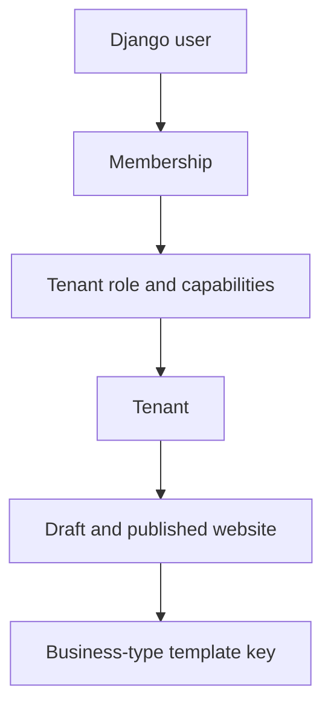
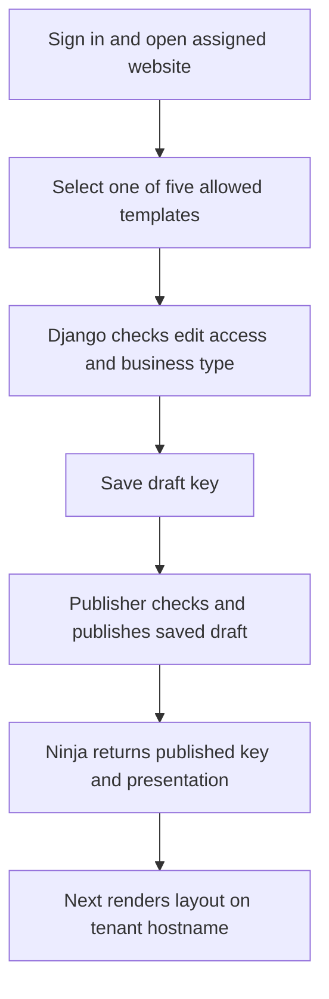

# Divisha v0.1 — 9 tenants, 15 template choices

Yeh pilot uploaded v0.1, Git HEAD `c5f00dd`, ke liye hai. Is ZIP mein application patch aur yeh guide hai. Har demo owner ka apna tenant hai. Maine existing Jeetu, Teal, Apex aur Horizon accounts ki jagah **9 naye pilot tenants** choose kiye, taaki aap same database par bhi unke existing records par asar dale bina demo add kar sakein. Agar existing 4 tenants already seeded hain, total 13 honge.

## Theory — user, tenant aur template ka relationship



Login identifies the user. Membership gives the user rights on a tenant. The tenant website owns its published template. Isliye agar aage ek website ke do staff accounts hon, dono same public layout manage karenge. Business type decides which templates appear in the dropdown.



Public visitor ka hostname `Domain → Tenant → Website` chain se resolve hota hai. Django Ninja `/api/page/?host=…` publish snapshot read karta hai. Usi JSON mein existing `template` key aur naya `presentation.layout` / `presentation.palette` milta hai. Next allowlisted layouts render karta hai. Login link shared Django login par jata hai. Agar browser pehle se kisi aur account mein signed in hai, private window ya Sign out use karein.

## 15 choices

| Layout | Restaurant | Education | Tour & Travel |
|---|---|---|---|
| Classic | Restaurant Classic | Education Classic | Explorer |
| Split | Dhaba | Admissions | Adventure |
| Editorial | Bistro | Campus | Heritage |
| Card | Café | Learning Studio | Escape |
| Banner | Night Dining | Open Day | Holidays |

Is implementation mein 15 category-specific choices **5 reusable responsive layouts** aur palettes se compose hoti hain. Split layout title aur content ko columns mein rakhta hai. Editorial serif typography aur divider use karta hai. Card content ko framed card mein rakhta hai. Banner solid header and separate details section use karta hai. Pilot existing title/description content contract par chalta hai. Booking, travel packages, restaurant menus aur education admissions forms separate content/features honge.

## 1. Patch apply karein

Download ZIP extract karein. Project root mein woh directory open karein jisme `backend/`, `frontend/` aur `.git/` hain. Apne existing edits check karke pilot branch banayein. Patch path aapke actual download folder ke hisaab se replace karein.

```bash
git status --short
git switch -c feature/template-pilot
git apply --check ~/Downloads/divisha-template-pilot.patch
git apply ~/Downloads/divisha-template-pilot.patch
git diff --check
git status --short
```

`git apply --check` agar overlap report kare, underlying file differences inspect karein. Patch working tree update karta hai. New files ko commit ke samay explicitly stage karein.

## 2. Django local database setup

Aap already local PostgreSQL use kar rahe hain toh existing PG configuration continue karein. Isolated first run ke liye neeche SQLite example hai. Use an empty DB file outside your repo.

```bash
cd backend
source .venv/bin/activate
pip install -r requirements.txt
export DIVISHA_LOCAL=1
export DIVISHA_SQLITE=1
export DIVISHA_SQLITE_PATH="$HOME/divisha-template-pilot.sqlite3"

python manage.py migrate
python manage.py seed_landings
python manage.py seed_template_pilot
python manage.py test
```

`seed_landings` platform aur Restaurant sample landing create karta hai. `seed_template_pilot` Education aur Tour landings create karta hai jab unke type ka landing missing ho. Ye existing landings, website drafts, published sites aur account passwords preserve karta hai. Existing type landing agar draft state mein hai toh operator admin se publish karein. Default demo accounts ke passwords **unusable** hote hain jab tak aap password set nahi karte. Set one password to begin, or run the loop for all nine. Each iteration opens Django's password prompt.

```bash
for account in \
  pilot_tandoor_restau_admin pilot_highway_restau_admin pilot_copper_restau_admin \
  pilot_maple_edu_admin pilot_river_edu_admin pilot_oak_edu_admin \
  pilot_summit_tour_admin pilot_wild_tour_admin pilot_fort_tour_admin
do
  python manage.py changepassword "$account" || break
done
python manage.py runserver 127.0.0.1:8000
```

Already activated venv ka path different ho toh wahi venv use karein. Agar purane 4 sample sites bhi **fresh** pilot DB mein chahiye, `python manage.py seed_stage` separately chal sakta hai. Platform admin account fresh pilot DB mein zarurat par `python manage.py createsuperuser` se banayein.

## 3. Next.js start karein

Doosri terminal, project root se:

```bash
cd frontend
npm ci
DJANGO_API_ORIGIN=http://127.0.0.1:8000 npm run dev
```

| Local hostname at port 3000 | Django username | Initial public template |
|---|---|---|
| `pilot-tandoor-restau.localhost` | `pilot_tandoor_restau_admin` | Restaurant Classic |
| `pilot-highway-restau.localhost` | `pilot_highway_restau_admin` | Dhaba |
| `pilot-copper-restau.localhost` | `pilot_copper_restau_admin` | Bistro |
| `pilot-maple-edu.localhost` | `pilot_maple_edu_admin` | Education Classic |
| `pilot-river-edu.localhost` | `pilot_river_edu_admin` | Admissions |
| `pilot-oak-edu.localhost` | `pilot_oak_edu_admin` | Campus |
| `pilot-summit-tour.localhost` | `pilot_summit_tour_admin` | Explorer |
| `pilot-wild-tour.localhost` | `pilot_wild_tour_admin` | Adventure |
| `pilot-fort-tour.localhost` | `pilot_fort_tour_admin` | Heritage |

Category pages `http://restau.localhost:3000/`, `http://edu.localhost:3000/` aur `http://tour.localhost:3000/` are shared landing routes. Homepage at `http://localhost:3000/` lists published business categories.

## 4. Pehla template test

1. Open `http://pilot-highway-restau.localhost:3000/`. Current template Dhaba hai.
2. Tenant Login → `pilot_highway_restau_admin` se sign in → Highway Dhaba open karein.
3. Template dropdown mein Restaurant ki paanch choices dekhein. **Night Dining** select karke **Save draft** karein.
4. Public page refresh karein. Dhaba abhi bhi live hona chahiye.
5. Panel mein **Publish saved draft** click karein. Public page refresh karne par Night Dining layout dikhna chahiye.
6. Usi session se `http://127.0.0.1:8000/panel/t/pilot-wild-tour/` open karein. Expected status 404. Wild Routes account apne login session se apna page manage karega.

Pilot owner ke paas existing `website.view`, `website.edit` aur `website.publish` hain. A website editor can save template drafts. Existing publish restrictions continue to apply.

## 5. Code map aur future updates

| Code | Role |
|---|---|
| `backend/websites/registry.py` | Five choices per type. One `Template(key, label, layout, palette)` entry per choice. |
| `backend/websites/models.py` | `Website.clean()` blocks a template from another type on validated writes. Existing draft/live columns reused. |
| `backend/websites/views.py` → `services.py` | Dropdown filters by tenant business type. Services authorize, validate, save and publish with audit. |
| `backend/websites/migrations/0003_expand_template_choices.py` | Django field choice migration for both keys. No new template tables or tenant-content copy. |
| `backend/websites/management/commands/seed_template_pilot.py` | Idempotent demo command. Creates domains, accounts, tenant roles and published demo websites in one DB transaction. |
| `backend/websites/api.py` | Adds public presentation metadata for the published template. |
| `frontend/templates/TenantSite.tsx` + `TenantSite.module.css` | Reusable rendering and palettes. Called by the existing Next catch-all page. |
| `backend/websites/tests.py` | Repeated seed, 5-per-type, three distinct templates per type, cross-type selection rejection, isolation and draft/publish transition. |

A sixth template using an existing layout needs a registry entry, optionally a CSS palette, and a generated Django choice migration. A new layout also needs a frontend layout entry and corresponding CSS. Template choices are **code-defined in this pilot**. Tenant selections and published state are database-backed. A later database catalog can make availability and labels operator-editable against deployed layout keys.

## 6. PythonAnywhere and Vercel

Local seed registers exact `.localhost` tenant hosts. For a live demo, apply the patch to the actual project branch, build both deployments, run the migration using the live backend database configuration, and seed there only when you intend to add demo accounts. Configure category hosts and desired tenant hosts on the frontend/DNS and add exact production tenant hostname rows via Django platform admin. `seed_template_pilot` does not register public tenant domains. Verify legacy tenants first. Activate new template choices in usage after the new frontend renderer is deployed. Local and PythonAnywhere records can differ even when code is the same.

## Verification

The patch was checked against the uploaded source. Django migration check, migration on separate SQLite, all 10 backend tests and the Next production build completed successfully. A local HTTP smoke test rendered all nine tenant sites and all three category landings through Next and Django. Production migration, DNS and production data changes are outside this local pilot.
