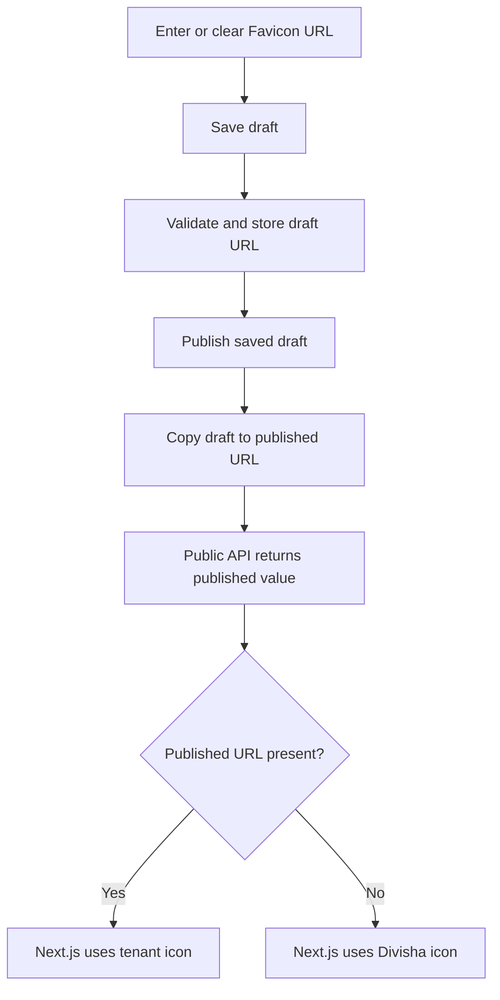

# Divisha Business OS — Tenant Website Favicon

## 1. Overview

A favicon is the small icon a browser shows beside a page title. Divisha tenants can publish their own favicon on their public website. When a tenant has no published favicon URL, the public website shows the Divisha **D**. The Tenant Admin login and signed-in panels use Divisha branding.

The favicon follows the existing **Save draft → Publish saved draft** workflow. An editor can save a replacement URL while visitors continue seeing the last published icon. Clearing the draft URL and publishing it restores the Divisha fallback.

The draft field accepts HTTPS URLs. HTTPS protects the image request in transit and avoids referencing an HTTP icon from an HTTPS page. Django validates the URL format and scheme. The browser or `curl` check in Section 5 verifies whether the URL actually serves an image.

## 2. How the feature works



> **Save before Publish.** The Publish button reads the last saved draft. It does not submit edits from the draft form.

## 3. Implementation by file

In each diff, lines starting with `-` are removed or replaced, lines starting with `+` are added, and unmarked lines show where the edit belongs. Use the code anchors because line numbers can change across branches.

| File | Change |
|---|---|
| `backend/websites/models.py` | Add a draft URL, a published URL, and HTTPS validation. |
| `backend/websites/migrations/0005_website_favicon_urls.py` | Generate the schema migration. The number depends on the branch. |
| `backend/websites/services.py` | Save the incoming draft and copy it on Publish. |
| `backend/websites/views.py` | Expose the field and handle omitted values. |
| `backend/websites/api.py` | Expose the published URL in the public response. |
| `frontend/app/[[...slug]]/page.tsx` | Set browser favicon metadata using the tenant URL or Divisha fallback. |

### 3.1 `backend/websites/models.py`

**Replace** the existing validator import near the top of the file.

```diff
-from django.core.validators import validate_domain_name
+from django.core.validators import URLValidator, validate_domain_name
```

**Add** the two fields inside `class Website`, between `published_contact` and `published_template`.

```diff
     published_contact = models.TextField(blank=True, editable=False)
+    draft_favicon_url = models.URLField(
+        max_length=500,
+        blank=True,
+        validators=[URLValidator(schemes=["https"])],
+        help_text="Enter the HTTPS URL of your favicon. Leave blank to use the Divisha icon.",
+    )
+    published_favicon_url = models.URLField(
+        max_length=500,
+        blank=True,
+        editable=False,
+    )
```

| Field or option | Why it is here |
|---|---|
| `draft_favicon_url` | Holds the tenant’s editable URL independently of the live value. |
| `published_favicon_url` | Holds the last published value for the public API. |
| `URLField` | Stores URL text and provides URL-format validation. |
| `max_length=500` | Limits the complete URL, including its query string. |
| `blank=True` | Lets existing tenants keep the fallback and lets editors clear a custom icon. |
| `URLValidator(schemes=["https"])` | Rejects non-HTTPS draft URLs when validation runs. |
| `help_text` | Explains the HTTPS requirement and fallback in the form. |
| `editable=False` | Keeps the published field out of generated model forms. The publish service sets it. |

**Checkpoint:** Generate and apply the database migration in Section 4 before you use the updated model against your local database.

### 3.2 `backend/websites/services.py`

**Replace** the optional-fields loop header inside `update_site()`, in the `EDIT_SITE` branch. Keep its body.

```diff
-        for field in ("draft_offerings", "draft_hours", "draft_contact"):
+        for field in (
+            "draft_offerings",
+            "draft_hours",
+            "draft_contact",
+            "draft_favicon_url",
+        ):
             if field in fields:
                 setattr(site, field, fields[field])
                 changes.append(field)
```

**Add** the assignment immediately after `site.published_contact = site.draft_contact`. Then add the published field to the `changes` list in the same `PUBLISH_SITE` branch.

```diff
         site.published_contact = site.draft_contact
+        site.published_favicon_url = site.draft_favicon_url
         changes = [
             "published_template", "published_title", "published_description", "published_at",
             "published_offerings", "published_hours", "published_contact",
+            "published_favicon_url",
         ]
```

**Why here:** The service already owns tenant website writes and runs the capability check, validation and audit logic. `site.save(update_fields=...)` writes only the fields in its update list, so both the assignment and the `changes` entry are required.

### 3.3 `backend/websites/views.py`

**Add** the field label in `DraftForm.__init__()`, after `offerings_field.help_text` is set and before the hours and contact labels.

```diff
+        self.fields["draft_favicon_url"].label = "Favicon URL"
         self.fields["draft_hours"].label = "Opening hours"
```

**Replace** the field list under `DraftForm.Meta`.

```diff
-        fields = ["draft_title", "draft_description", "template", "draft_offerings", "draft_hours", "draft_contact"]
+        fields = [
+            "draft_title",
+            "draft_description",
+            "template",
+            "draft_offerings",
+            "draft_hours",
+            "draft_contact",
+            "draft_favicon_url",
+        ]
```

**Replace** the repeated optional-field tuples in `panel()`. The first loop is just after the fallback for `template`. The second is inside `if form.is_valid():`.

```diff
         if "template" not in fields:
             fields["template"] = site.template
-        for field in ("draft_offerings", "draft_hours", "draft_contact"):
+
+        optional_fields = (
+            "draft_offerings",
+            "draft_hours",
+            "draft_contact",
+            "draft_favicon_url",
+        )
+        for field in optional_fields:
             if field not in fields:
                 fields[field] = getattr(site, field)
+
         form = DraftForm(fields, instance=site)
         if form.is_valid():
-            for field in ("template", "draft_offerings", "draft_hours", "draft_contact"):
+            for field in ("template", *optional_fields):
                 if field not in request.POST:
                     form.cleaned_data.pop(field)
             update_site(context, EDIT_SITE, form.cleaned_data)
             return redirect("tenant-panel", slug=slug)
```

**Why here:** The Django panel template already renders `{{ form.as_p }}`. Adding the form field makes the input appear. The first loop gives missing fields their existing values during form validation. The second loop removes omitted fields before calling the update service. An explicitly submitted empty value stays in `cleaned_data`, so the editor can clear the draft favicon.

### 3.4 `backend/websites/api.py`

**Add** the field after `contact` in `class PublishedPage(Schema)`.

```diff
     contact: str
+    favicon_url: str | None = None
```

**Add** the value after `contact` inside `return PublishedPage(...)` in `published_page()`.

```diff
         contact=site.published_contact,
+        favicon_url=site.published_favicon_url or None,
```

**Why here:** `PublishedPage` is the response schema for tenant sites. Reading the published field keeps drafts private. Converting the empty string to `None` gives the frontend a JSON `null` when it should use the fallback.

### 3.5 `frontend/app/[[...slug]]/page.tsx`

**Add** this constant after the imports and before `interface PublishedLanding` if you are rebuilding from before the fallback step. Keep the existing constant if it is already there.

```tsx
const DIVISHA_FAVICON =
  "data:image/svg+xml,%3Csvg xmlns='http://www.w3.org/2000/svg' viewBox='0 0 32 32'%3E%3Crect width='32' height='32' rx='7' fill='%23075e51'/%3E%3Cpath fill='white' d='M9 7h6a9 9 0 0 1 0 18H9zm4 4v10h2a5 5 0 0 0 0-10z'/%3E%3C/svg%3E";
```

The original `generateMetadata()` returned metadata on one line. In the initial fallback step, it was **replaced** with the following object.

```diff
-  return { title: page.title, description: page.description, alternates: { canonical } };
+  return {
+    title: page.title,
+    description: page.description,
+    alternates: { canonical },
+    icons: { icon: DIVISHA_FAVICON },
+  };
```

Once the API supplies `favicon_url`, **add** the lookup after the `canonical` calculation, just before the metadata return. **Replace** the fallback-only `icons` line.

```diff
+  const faviconUrl =
+    !("page_type" in page) &&
+    "favicon_url" in page &&
+    typeof page.favicon_url === "string"
+      ? page.favicon_url
+      : null;
+
   return {
     title: page.title,
     description: page.description,
     alternates: { canonical },
-    icons: { icon: DIVISHA_FAVICON },
+    icons: { icon: faviconUrl || DIVISHA_FAVICON },
   };
```

**Why here:** `generateMetadata()` sets the browser’s `<link rel="icon">`. At this point the page data is already loaded for the requested hostname. The `page_type` check leaves platform and business landing pages on the Divisha fallback. Tenant pages use the published URL when present.

## 4. Database migration and checks

From the repo root, activate your normal local virtualenv and load your local database settings. Then run:

```bash
cd backend
export DIVISHA_LOCAL=1
python manage.py makemigrations websites --name website_favicon_urls
```

Open the generated migration. Verify it contains two `AddField` operations on `Website`, for `draft_favicon_url` and `published_favicon_url`. If the previous migration is `0004`, the generated file will typically be `backend/websites/migrations/0005_website_favicon_urls.py`. Use the actual filename Django creates. No previous migration needs to be removed.

```bash
python manage.py migrate
python manage.py check
python manage.py showmigrations websites
python manage.py test websites
```

| Command | What it verifies or changes |
|---|---|
| `makemigrations` | Turns the model changes into a versioned database migration. |
| `migrate` | Applies pending migrations to the configured database. |
| `check` | Runs Django’s system checks for the loaded project configuration. |
| `showmigrations websites` | Shows which website migrations are applied. Look for `[X]` beside the favicon migration. |
| `test websites` | Runs the existing website tests, including regression coverage for draft, publish and tenant permissions. Use Section 5 for favicon-specific checks. |

Keep the generated migration with the model change in Git. Apply that same migration with `migrate` in each deployment environment.

## 5. Verify the feature end to end

### Find a direct HTTPS PNG URL

On your image host, use **Copy image address**, **Copy asset URL**, or **Open image in new tab**. A webpage URL opens an HTML preview or gallery. A direct image URL returns the image itself.

| Example | Expected behavior |
|---|---|
| `https://example.com/gallery/timcy-logo` | Opens a webpage containing the image. |
| `https://cdn.example.com/timcy/favicon.png` | Requests the PNG directly. |
| `https://cdn.example.com/assets/123?format=png` | Can also work if the final response serves the PNG. |

Open your real URL in a private browser window to confirm it loads without signing in. Prefer a stable public URL so the icon remains available after publication. To inspect the final response after redirects:

```bash
FAVICON_TEST_URL='https://cdn.example.com/timcy/favicon.png'

curl -fsSL -o /dev/null \
  -w 'Final URL: %{url_effective}\nStatus: %{http_code}\nContent-Type: %{content_type}\n' \
  "$FAVICON_TEST_URL"
```

For a direct PNG, expect a final HTTPS URL, status `200`, and `Content-Type: image/png`. A `text/html` response usually means you copied a webpage, login screen, or error page. The `.png` suffix alone cannot verify the response.

### Verify draft, publish, isolation and fallback

With Django and Next.js running locally, query the API using the hostname registered for Timcy in your local `Domain` table. Change the `host` value below if your database uses `timcy-tour.divisha.org`.

```bash
curl -fsS 'http://127.0.0.1:8000/api/page/?host=timcy-tour.localhost' |
  python -m json.tool
```

| Test | Expected result |
|---|---|
| Open `/panel/t/timcy-tour/` and save an HTTPS image URL as a draft. | The form shows the saved URL after reload. The API still returns the previous published value. |
| Click **Publish saved draft**. | The API returns the new URL in `favicon_url`. Timcy’s public tab shows that icon. |
| Open a second tenant with no custom favicon. | The second tenant still shows Divisha **D**. |
| Clear Timcy’s URL and save a draft. | The public API still returns the previous URL. |
| Publish the empty draft. | The API returns `"favicon_url": null` and the public tab shows Divisha **D**. |
| Open Tenant Admin login and the signed-in panel. | Both continue to show the Divisha favicon. |

If the API returns the right URL but the browser tab keeps the old icon, inspect the generated HTML. Replace the host below if needed.

```bash
curl -fsS http://timcy-tour.localhost:3000/ |
  rg -o '<link[^>]*rel="icon"[^>]*>'
```

If the `href` is correct, open it directly and retest in a private window. This helps distinguish an image-hosting issue from a cached browser favicon.

## 6. Quick reference

- [ ] Add and migrate both fields, `draft_favicon_url` and `published_favicon_url`.
- [ ] Confirm HTTPS validation and the **Favicon URL** form label.
- [ ] Verify **Save draft** leaves the public API value unchanged.
- [ ] Verify **Publish saved draft** updates the API and Next.js favicon.
- [ ] Verify the URL serves an image directly over HTTPS.
- [ ] Verify publishing an empty draft restores Divisha **D**.
- [ ] Check a second tenant and the Tenant Admin branding.